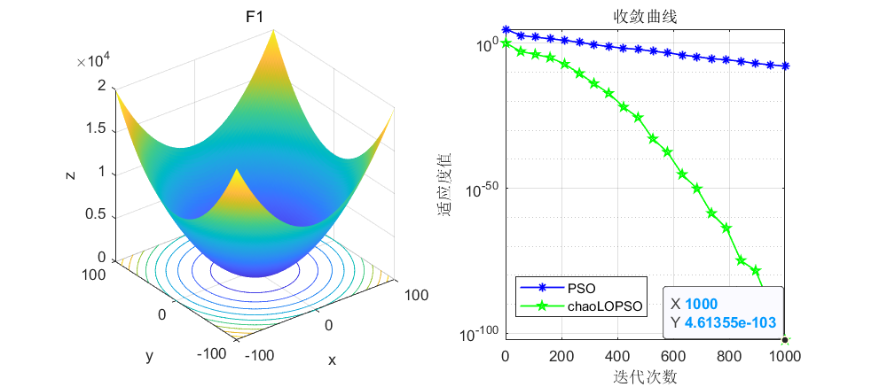
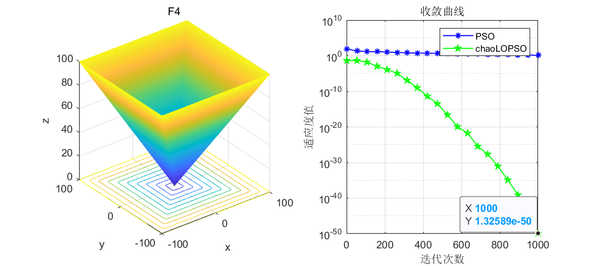
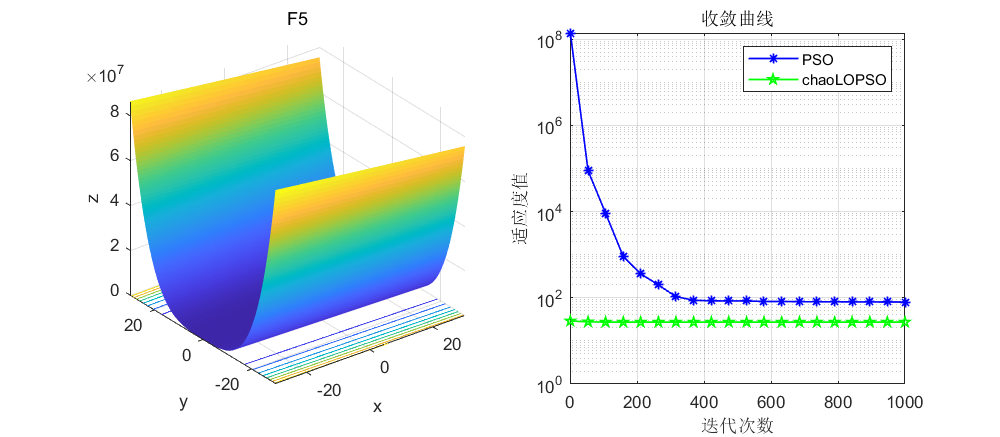
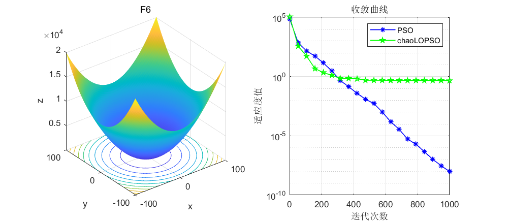
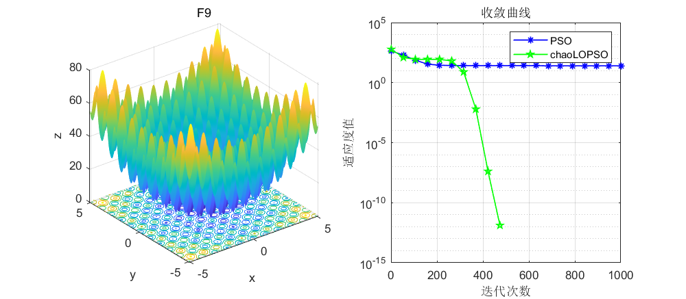
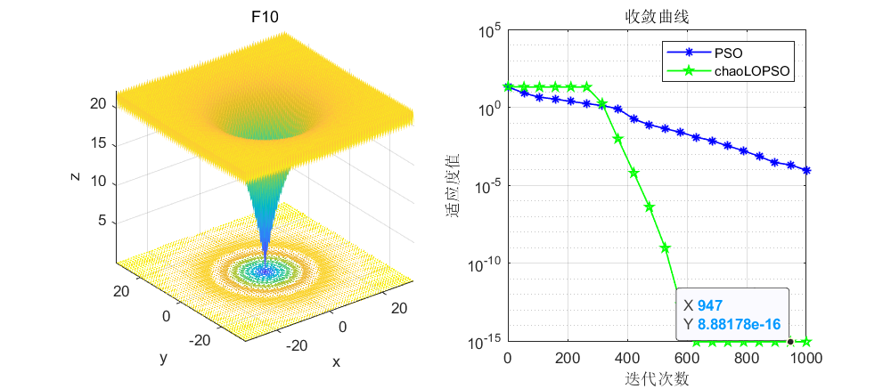
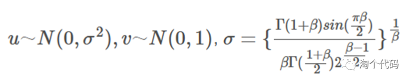
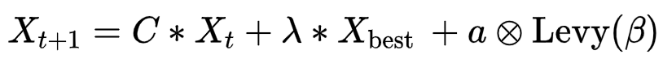

# Particle Swarm Optimization Algorithm Based on Improved Levin Flight and Chaos Maps (10 types of chaos maps randomly switched) with MATLAB code.

The article improves the Particle Swarm Optimization (PSO) algorithm by introducing a chaotic mapping mechanism to initialize the population, enhancing the diversity of individual particles. Furthermore, an improved Levy flight mechanism is incorporated into the position update formula for particle individuals, improving search accuracy and helping them escape local optima.

A variety of mapping functions can be selected from 1-10, corresponding to tent, Logistic, Cubic, Chebyshev, Piecewise, sinusoidal, Sine, ICMIC, Circle, Bernoulli. The choice of numbers allows for arbitrary switching between different functions.

Results are shown first, with the population set to 50 particles and the loop executed 3000 times on the CEC2005 function.

Here, the top 10 functions are selected for display, showing significant improvements in both convergence speed and optimization precision before and after the improvement.

Next, let's discuss the principles behind the enhancements.

Chaotic Mapping
Improved Levy Flight Mechanism
In this article, the addition of the Levy flight mechanism is not as straightforward as in other articles; instead, it has been slightly modified. This approach indeed yields better results than directly adding the Levy coefficient. The principle formula is as follows:

where α is the step size scaling factor and Levy(β) represents the Levy random path.

\n        \n
The principle is as follows:
where α=0.01.
The purpose of this is to complement the PSO with the Levy flight, dynamically adjusting the proportion coefficient for each optimization iteration.

Code is provided below:

## Images

<!-- PAYMENT_BLOCK -->

## Get this dataset

- Payment link (Stripe): [Buy now](https://buy.stripe.com/3cs8yP7sY87d0vu9AB)
- Payment QR code: 

<!-- /PAYMENT_BLOCK -->
